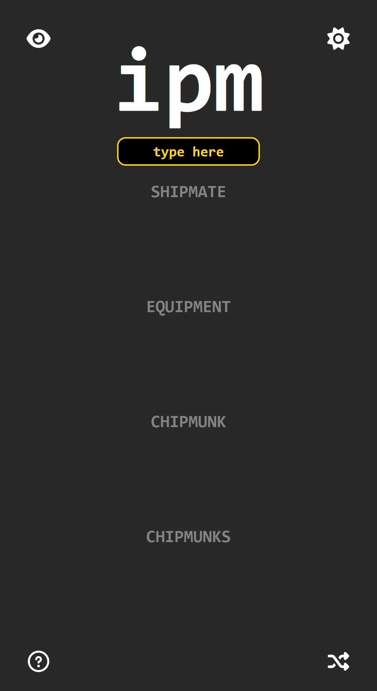
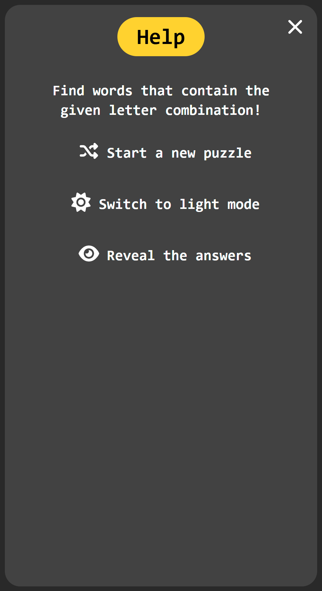

# Three Letters Game

<p align="center">
    
    
</p>

A small word game built with Next.js and React. You're given a three-letter combination (a trigram) and need to find as many English words as you can that contain it. Some features:

- Random trigram puzzles, weighted towards rarer combinations
- Feedback for words that are invalid, already found, or missing the trigram
- A revealable answer list with words you've already found greyed out
- Light/dark mode that follows the system preference and is remembered between visits
- Responsive layout for desktop and mobile
- Fully static export, deployed to GitHub Pages via GitHub Actions

## Dependencies

Requires Node.js (LTS) and npm. The app uses:

- [Next.js](https://nextjs.org) 16 and React 19
- [Tailwind CSS](https://tailwindcss.com) 4
- [Font Awesome](https://fontawesome.com) for icons
- [nanoid](https://github.com/ai/nanoid) for list keys

Install them with:

```sh
npm install
```

## Running

Start the development server:

```sh
npm run dev
```

Then open [http://localhost:3000/three-letters-game](http://localhost:3000/three-letters-game) (the app is served under the `/three-letters-game` base path set in `next.config.ts`).

To build the static site into `out/`:

```sh
npm run build
```

## Word data

The word list lives in `data/`:

- `words.csv` — the source word list, with frequency counts
- `valid_words.csv` — the words accepted by the game
- `trigram_to_word_idxs.json` — maps each trigram to the indices of the words containing it

`valid_words.csv` and `trigram_to_word_idxs.json` are generated from `words.csv` by `scripts/count_trigrams.ipynb`, which needs Python with `pandas` and Jupyter. Re-run it after changing the source word list.
